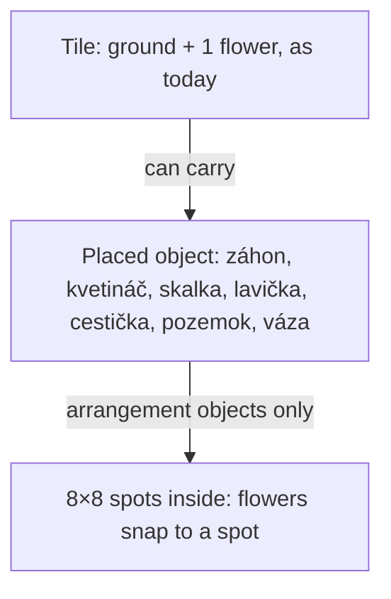
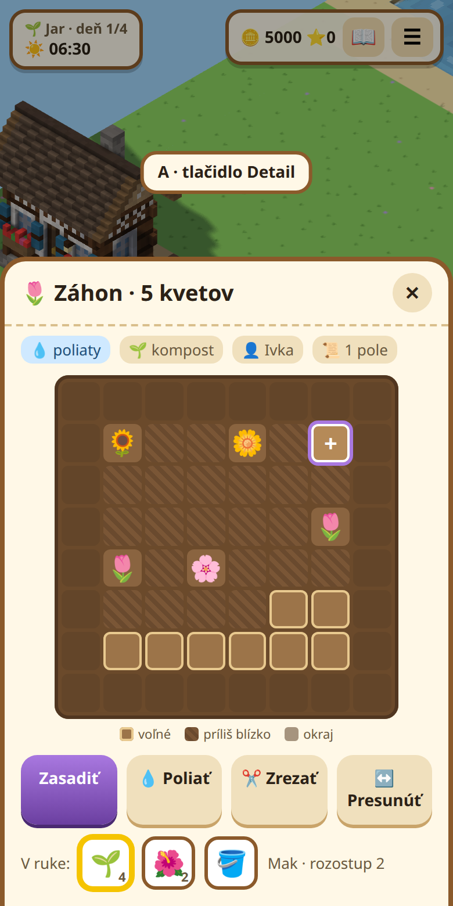
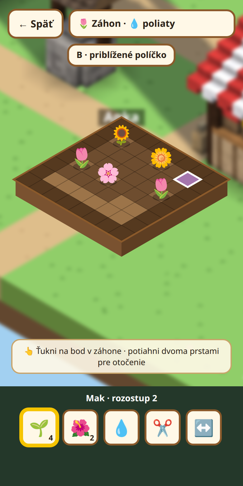
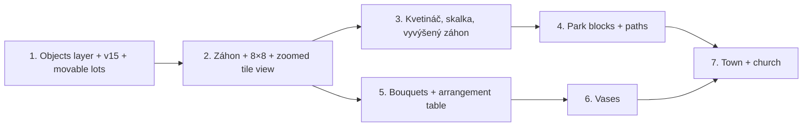

# Záhrada ako dekorácia – core model (#156)

Design proposal for the core model behind decorative gardens. It covers **what gets saved, how objects are shared,
how they count against the field permit and how the player edits them on a phone**. Gameplay rules that are still
open in #156 (item source, contests, bouquet rules, church interior) are out of scope here.

## One-sentence model

> A tile stays what it is today (ground + at most one flower). On top of the tiles lies a new, shared **layer of placed
> objects**. Arrangement objects (záhon, kvetináč, skalka, vyvýšený záhon) hold several flowers on an **8×8 grid of spots**.



Agreed in #156: shared and editable by everyone; several flowers only inside arrangement objects; step 1/8 of a tile;
the house is fixed, unbuilt lots are movable, built buildings stay put; one arrangement object = **1 slot** of the
shared Povolenie na pole, however many flowers it holds.

## 1. Object kinds

| Kind | Footprint | Holds | Blocks walking | Permit slots |
|---|---|---|---|---|
| `zahon` (záhon) | 1×1 | flowers, 8×8 spots | no | 1 |
| `vyvyseny` (vyvýšený záhon) | 1×1, later 1×2 | flowers, 8×8 spots, level 1 | yes | 1 |
| `kvetinac` (kvetináč) | 1×1, small | flowers, a few spots in the middle | yes | 1 |
| `skalka` (skalka) | 1×1, later 2×2 | flowers, spots between the rocks | yes | 1 |
| park blocks (`lavicka`, `plot`, `lampa`, …) | 1×1 / 1×2 | nothing | yes | 0 |
| `cesta` (cestička: štrk, dlažba, dosky, …) | 1×1 | nothing | no | 0 |
| `lot` (pozemok Ľadovne / Dielne) | 2×2 | nothing | no | 0 |
| `vaza` (váza) | spot in a church area (later) | a bouquet | – | 0 |

The first slice only needs `lot`; the other kinds arrive in later phases (see *Phasing*).

## 2. Save format (next version: v15 at the time of writing)

A new top-level list in `SaveFile`, with a migration from v11:

```ts
// src/shared/save.ts (proposal)
export type ObjKind = 'lot' | 'zahon' | 'vyvyseny' | 'kvetinac' | 'skalka' | 'lavicka' | 'cesta' /* … */;
export interface Spot { sx: number; sy: number; p: Plant }   // sx, sy = 0–7 inside the tile
export interface GardenObject {
  id: number;
  area: AreaId;
  x: number; y: number;          // top-left tile
  kind: ObjKind;
  rot?: 0 | 1 | 2 | 3;           // quarter turns
  v?: string;                    // variant: path material, which building a lot is for ('icehouse' | 'dielna'), …
  lvl?: number;                  // height level (vyvýšený záhon = 1); no free stacking yet
  w?: number; r?: number;        // watered / composted today – per object, like Soil
  spots?: Spot[];                // arrangement objects only
  o: PlayerKey;                  // who placed it (shown in the UI, not ownership: everyone may edit)
}
export interface SaveFile { v: 15; /* … */ objects: { list: GardenObject[]; nid: number } }
```

- **Migration 14 → 15** (`migrate()` in `server.ts`, `SAVE_VERSION = 15`): add `objects` with **two `lot` objects at
  today's fixed positions** (ice house next to the house, Dielňa next to the market), so no garden changes. Built
  buildings keep their tiles as they are.
- the current save fixture stays as the migration input; a new fixture from a real server is added once
  phase 1 runs.
- Flowers in spots reuse the existing `Plant` type, so growth, wilting, quality, wild seeds and the herbarium keep
  working the same way.

## 3. Lots become data

Today `lotIdx()` in `ice.ts` and `dielna.ts` hard-codes the 2×2 lots. With the objects layer:

- `lotIdx()` reads the `lot` object with the matching `v`, not a constant.
- **Moving a lot** works on a free 2×2 area only: grass, no soil, no object, not the house, not a passage. Anyone
  can move it, as long as the building is not built yet.
- **Building** works as today: the tiles become the `icehouse` / `dielna` ground, so `BLOCK`, `CORNER_WALL` and the
  3D models keep working, and the `lot` object is removed (proposal: the smallest change). Built buildings are immovable.

## 4. Soil, objects and the field permit

- A tile carries **either** soil (`t.s`, one flower) **or** an arrangement object, never both.
- The permit counts `tiles with soil + arrangement objects`. `plotsUsedOf()` and the `plotsUsed` counter add up both;
  park blocks, paths and lots count 0.
- **Placing on a tilled tile is refused** (agreed): "Najprv zarovnaj motykou." A záhon only goes on grass without soil or another object.
- **Watering per object** (agreed): one pour of the krhla waters the whole záhon (`w` on the object). This is one of the
  advantages of a záhon over single tilled tiles. The compost (`r`) works the same way.

## 5. Spacing inside an arrangement object

- A flower takes one spot (sx, sy ∈ 0–7). Proposed rules:
  - **Keep-out margin:** the outer ring (sx or sy = 0 or 7) stays free in a záhon, so beds don't touch visually.
    A kvetináč only allows the middle 4×4, and a skalka only the spots between its rocks (fixed per model).
  - **Spacing:** two flowers must be at least *d* spots apart (Chebyshev distance). *d* depends on the species: small
    flowers 1, bushy ones 2 (a new `space` field in `SPECIES`, default 1).
  - The result is about 9 bushy or 36 small flowers in a 6×6 inner area.
- Validation lives on the server (`actions.ts`) and is shared with the client (`src/shared/`), so the detail view
  can grey out invalid spots before sending.

## 6. Growth reuse

`growPlant(tiles, i, tick, se, eternal)` in `events.ts` takes a tile index. Split it into:

- `growOne(p: Plant, soil: { w; r }, tick, se, eternal)`, which grows one plant using the watering of its container;
- the dawn pass calls it for every tile with soil (as today) **and** for every spot of every arrangement object.

Seed reveal (`revealWild`) and the herbarium credit go through the same path, so a wild seed in a záhon is credited
to `o` like a tilled tile today.

## 7. Engine slices, journal, protocol

Following AGENTS.md (proposers read and write through `sl()` / `put()` / `maybe()`):

- New slice keys: `obj:<area>:<id>` → `GardenObject | undefined` and `obj:<area>:*` → `GardenObject[]`, with the
  entries in `KeyedSlice` and `sliceOf()` (`engine.ts`), plus `objNid` for new ids.
- An action that places an object on a tile declares both `tile:<area>:<i>` (for the soil and ground check) and
  `obj:<area>:*` (for overlaps). Placing and moving conflict with each other through these keys, so two players
  can't drop objects on the same tile in one round.
- `JournalLine` and `test/journal.fixture.ts` get the new slices.
- **Protocol:** `ObjectView` (= `GardenObject` with `PlantView` in spots) and an `objects` list in the area
  snapshot, plus a delta message `obj` (added / changed / removed).

## 8. Walking and height

- `BLOCK` is keyed by `Ground`; objects need their own flag per kind (`OBJ_BLOCK`, table above) and a height
  contribution for the 3D terrain (`vyvyseny` = +0.4).
- Collision on the server and the client checks `BLOCK[ground] || objBlocks(tile)`.
- **Multi-level planting** = `lvl` on the object (vyvýšený záhon 1, kvetináč on a vyvýšený záhon or on a wall 2).
  Free stacking and walking on levels are deferred.

## 9. Editing and input (mobile first)

- With an object kind in hand (bought or crafted, item source still open, #156 Q8), **E / tap** on the tile in front
  places it, and the same action with the hoe removes an empty one (as levelling a tile today).
- **E on an arrangement object with seeds, a cut flower or empty hands opens the detail view**: an 8×8 grid of
  spots for this one tile, where the player taps a spot to plant, water, harvest or pull. The two ways to open it
  are the open mobile question:

| A: detail button | B: zoomed tile view |
|---|---|
|  |  |
| A panel over the game with a flat 8×8 grid; the 3D view stays as it is. Simple, works with the existing overlay, readable on any phone. | The 3D camera zooms onto the tile and the grid is drawn on the tile itself. Prettier and more "in the world", but needs a camera mode and touch picking. |

  **Decided: B, the zoomed tile view** (it looks nicer). What it needs:
  - a camera mode in `render3d.ts` that flies to one tile, keeps the rest of the garden blurred or dimmed, and
    returns with **Späť**;
  - touch / mouse picking of a spot on the tile (ray → tile plane → sx, sy), with a highlight of the picked spot and
    greyed spots that break the spacing;
  - the hotbar stays at the bottom with the actions (zasadiť, poliať, zrezať, presunúť);
  - rotating the view in steps works as today (the ⟲ ⟳ buttons), so no new gestures are needed.
  Mockup A stays in the repo for reference only.
- Moving a lot or a park block: the **"Presunúť"** button in the detail panel, then walk to the new place and press E.
  No drag gestures needed.

## 10. 3D and debug

- One `FineModelEntry` per object kind in `world3d.ts` (group *Objekty*), so every model is visible on the 3D
  models debug tab. A per-object render pass draws objects on top of the terrain, and flowers in spots reuse the
  existing flower meshes, scaled down.
- The debug **Map** tab (#77) shows objects. A cheat (#153 style) places, moves and removes objects for testing.

## Phasing



1. **Objects layer + save migration + movable lots.** No new object kinds yet, but it touches every layer (save,
   slices, protocol, 3D, input) with the least game-design risk.
2. **Záhon + 8×8 spots + zoomed tile view (B).** The first decorative planting.
3. **Kvetináč, skalka, vyvýšený záhon** (spot masks, levels).
4. **Park blocks + path types.**
5. **Bouquets** on the aranžovací stôl (rules from #156 Q10).
6. **Vases.**
7. **Town and church** (interior rendering, generic decoration areas holding vases).

The visual unification (texture round + debug texture tool) runs in parallel and has its own issue.

## Out of scope here

Item source and pricing (#156 Q8), contests (Q9), bouquet rules (Q10), vase effects (Q11), the texture tool (Q12),
church size and interior rendering (Q19).
